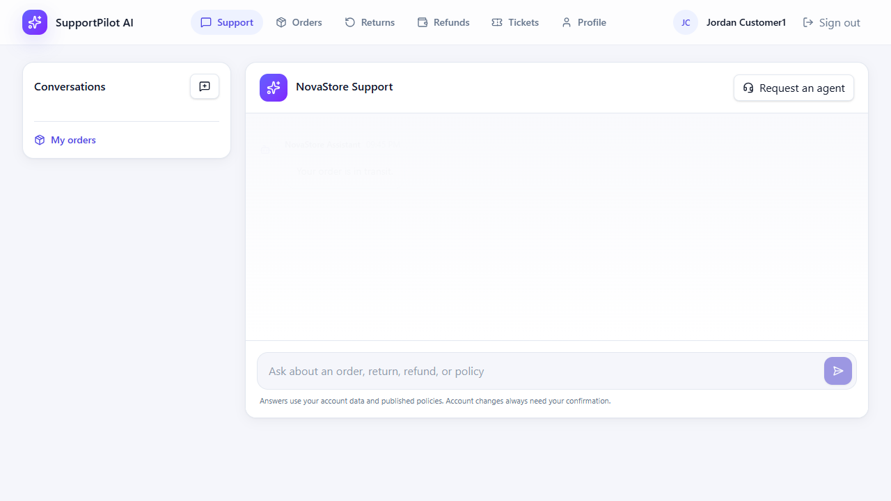
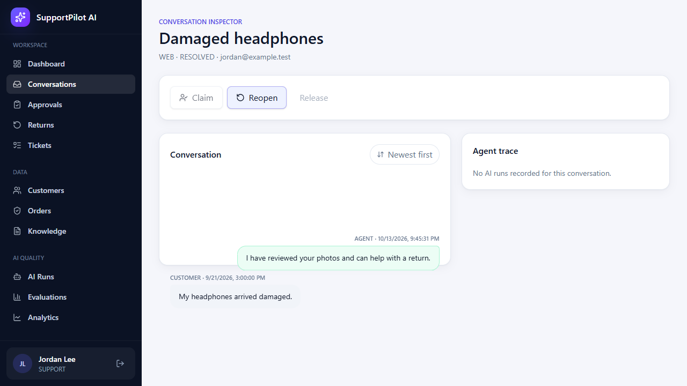
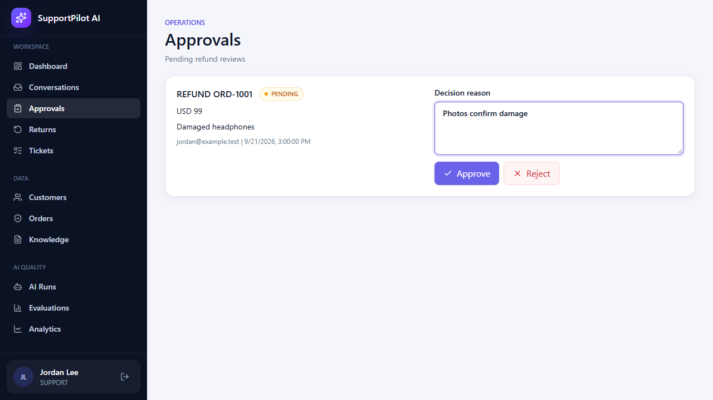
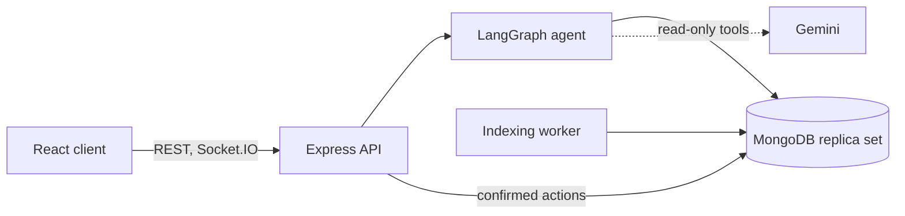

# SupportPilot AI

Customer-support platform for a fictional online store, built around a LangGraph agent. Customers chat about orders and policies, staff handle escalations, returns and refunds, and every change to an account goes through an explicit confirmation and an audit trail.



## Features

- **Support agent** built with LangGraph. Messages are routed to order, policy, resolution or human-handoff nodes. Answers are grounded in the customer's orders and retrieved policy text, with citations.
- **Read-only model.** Gemini (through LangChain) can read orders and search the knowledge base, but it has no write tools. Cancellations, address changes, returns and refunds are confirmed by the customer in the UI, applied in a transaction with an idempotency key, and recorded in an audit log.
- **Routing.** Keyword rules handle clear intents; a small Gemini classifier handles paraphrases the rules miss.
- **Guardrails.** Card numbers and secrets are redacted before storage, prompt-extraction attempts are refused, claims that an action was completed are removed, and order answers must mention the customer's real orders.
- **Streaming.** Progress steps and answer text stream to the chat over Socket.IO.
- **Fallbacks.** Models are tried in a configurable order with per-attempt time limits. If none respond, the answer is built from the retrieved evidence instead.
- **Staff tools.** Claim, reply, resolve and reopen conversations; review returns and inspections; approve refunds with a written reason; manage knowledge documents; inspect agent runs.
- **Knowledge search.** Versioned chunks with lexical search, plus optional vector and hybrid search.
- **Evaluation.** Offline agent fixtures, a labeled retrieval benchmark (Recall@3, MRR) and a live routing evaluation.

|                         Staff handoff                          |                     Refund approval                      |
| :------------------------------------------------------------: | :------------------------------------------------------: |
|  |  |

## Architecture



- [docs/architecture.md](docs/architecture.md): modules, workflows, data and operations
- [docs/agents.md](docs/agents.md): agent graph, routing, guardrails, streaming, recovery

## Tech stack

TypeScript, Node.js 20+, Express 5, MongoDB (Mongoose), LangGraph, LangChain (Google GenAI), Socket.IO, Pino, React 19, Vite, TanStack Query, Tailwind CSS, Vitest, Playwright, pnpm workspaces.

## Getting started

You need Node.js 20+, pnpm 10+ and a local `mongod` (MongoDB 7 or newer). MongoDB has to run as a replica set because the confirmed actions use transactions.

```bash
pnpm install
cp .env.example .env      # set two different JWT secrets (24+ characters)
pnpm db:start             # starts a single-node replica set on 127.0.0.1:27018
pnpm seed                 # demo data; refuses to run on a non-empty database
pnpm ingest:knowledge     # indexes docs/knowledge/*.md
pnpm dev                  # API on :4000, client on :5173
```

`pnpm db:start` prints the `MONGODB_URI` to put in `.env`. Stop the database with `pnpm db:stop`; data is kept in `.runtime-mongo-dev/`. If `mongod` isn't on your `PATH`, set `MONGOD_BINARY`.

To use Docker instead, `docker compose up -d mongo` starts a replica set on port 27017, and `docker compose up --build` runs the whole stack from `.env`.

### Demo accounts

All use the password `demo-password`.

| Role     | Email                       |
| -------- | --------------------------- |
| Customer | `customer01@novastore.demo` |
| Customer | `customer02@novastore.demo` |
| Support  | `support@novastore.demo`    |
| Admin    | `admin@novastore.demo`      |

### Things to try

1. As a customer, ask "Where is my latest order?" and "What is the return policy for damaged items?" and open the cited sources.
2. Open an order, request a return, then as support approve it, mark it received and complete the inspection.
3. Request a refund as the customer, then approve it from **Approvals** as staff.
4. Type "I want to talk to a human", then claim and reply from **Conversations** as support.
5. As admin, add a knowledge document, watch it index and search it, then run the evaluations.

## Configuration

| Variable                                   | Description                                                           |
| ------------------------------------------ | --------------------------------------------------------------------- |
| `MONGODB_URI`                              | MongoDB replica-set connection string                                 |
| `JWT_ACCESS_SECRET`, `JWT_REFRESH_SECRET`  | Two different secrets, 24+ characters each                            |
| `CLIENT_URL`                               | Allowed browser origin (default `http://localhost:5173`)              |
| `GEMINI_API_KEY`                           | Optional. Enables model answers and model routing                     |
| `GEMINI_CHAT_MODEL`, `GEMINI_ROUTER_MODEL` | Comma-separated model lists, tried in order                           |
| `KNOWLEDGE_SEARCH_MODE`                    | `lexical` (default) or `hybrid` (needs embeddings and a vector index) |
| `TRUST_PROXY`                              | Number of reverse-proxy hops, for rate limiting                       |

Environment variables set in the shell override `server/.env`, which overrides the root `.env`. Without a Gemini key the app still works and answers from the retrieved data.

## Scripts

| Command                                            | Description                                                              |
| -------------------------------------------------- | ------------------------------------------------------------------------ |
| `pnpm dev`                                         | Start the API and the client                                             |
| `pnpm build`                                       | Build both packages                                                      |
| `pnpm lint`, `pnpm typecheck`, `pnpm format:check` | Static checks                                                            |
| `pnpm test`                                        | Unit and integration tests (integration tests start a temporary MongoDB) |
| `pnpm e2e`                                         | Browser tests against mocked API responses                               |
| `pnpm smoke`                                       | Exercise every workflow against a running API; use a throwaway database  |
| `pnpm eval:live`                                   | Score routing accuracy with the real model (needs `GEMINI_API_KEY`)      |

## Limitations

- Refund approval does not move money; there is no payment or shipping integration.
- Agent state is rebuilt from stored messages. There are no LangGraph checkpoints, so a run that is cut off is cleaned up but not resumed.
- Rate limits are kept in memory, so running several API instances would need a shared store.
- Lists are capped rather than paginated, and ticket handling is limited to status changes.
- Vector and hybrid search, and the Docker setup, have not been exercised in automated tests.

## License

No license has been chosen yet.
