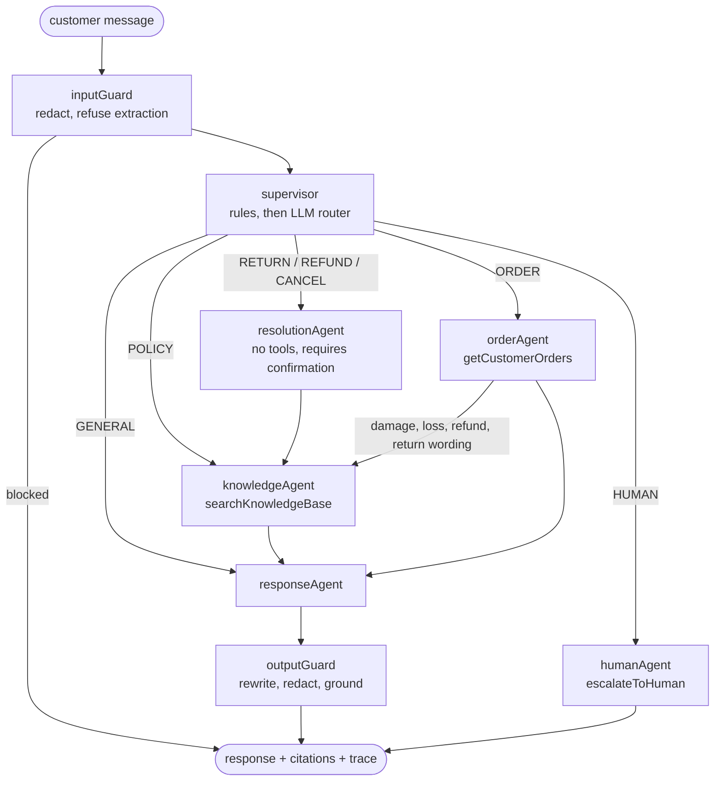

# Agent design

The support agent is a LangGraph `StateGraph` defined in `server/src/modules/agent/graph/support.graph.ts`. Each customer message runs one pass through the graph; conversation history is rebuilt from persisted messages.

## Routing

| Intent                 | Specialist      | Tools executed by the graph            | Outcome                                                         |
| ---------------------- | --------------- | -------------------------------------- | --------------------------------------------------------------- |
| HUMAN                  | HumanEscalation | `escalateToHuman`                      | Conversation moves to WAITING; the agent pauses (HTTP 409)      |
| POLICY                 | KnowledgeAgent  | `searchKnowledgeBase`                  | Cited answer from published policy passages                     |
| ORDER                  | OrderAgent      | `getCustomerOrders`                    | Order status answer                                             |
| RETURN, REFUND, CANCEL | ResolutionAgent | `searchKnowledgeBase` (policy context) | Guidance only; the customer confirms the action in the order UI |
| GENERAL                | Supervisor      | none                                   | Greeting / clarification                                        |

Routing is a cheap-first cascade (`routing/llm.router.ts`):

1. **Rules** (`routing/rules.ts`) decide clear intents deterministically with no model call.
2. **LLM router**: messages no rule recognises ("my parcel hasn't turned up", "get me a real agent") are classified by a small Gemini model using structured output constrained to the intent enum. The message is treated as untrusted data.
3. **Fallback**: if the model is unavailable the intent becomes GENERAL, where the answering model can still call the read-only tools itself.

The method used (`rules`, `llm`, `fallback`) is stored on every trace. `pnpm eval:live` measures rules-only against the cascade on a labeled set that includes paraphrases.

## Response generation

`responseAgent` calls Gemini through LangChain (`providers/chat.provider.ts`) when `GEMINI_API_KEY` is set. The model:

- sees authorized tool evidence and the last 12 messages, treated as untrusted data;
- may call only the read-only tools `getCustomerOrders`, `getOrderTracking` and `searchKnowledgeBase`, with a budget of 4 turns and 6 tool calls and a 30 s timeout;
- never receives write tools or user IDs; ownership comes from the authenticated session;
- is told the real UI (Request an agent button, Orders page confirmation) and forbidden from speculating or inventing screens, contacts or deadlines.

`GEMINI_CHAT_MODEL` and `GEMINI_ROUTER_MODEL` accept comma-separated lists. On overload, quota or timeout the next model is tried inside one shared deadline (`providers/model.chain.ts`); logic errors are not retried. If every model fails, or no key is set, the graph answers deterministically from retrieved evidence and records `deterministic` or `deterministic-fallback` as the model.

## Guardrails

Two graph nodes wrap every run (`agent/guardrails/`), and each result is stored on the trace and as a safety note on the message.

| Stage  | Check                                                                  | Action                                                                  |
| ------ | ---------------------------------------------------------------------- | ----------------------------------------------------------------------- |
| Input  | Card numbers (Luhn-checked), ID numbers, API secrets                   | Redacted before anything is stored or sent to a model; customer is told |
| Input  | Attempts to extract the system prompt or switch persona                | Refused before any tool or model runs                                   |
| Input  | Instruction overrides ("ignore all rules")                             | Flagged; handled as untrusted data, never obeyed                        |
| Output | Claims that an account action was completed ("I have refunded you")    | Sentence removed, "no changes were made" notice added                   |
| Output | Order questions whose answer never mentions the customer's real orders | Verified order details are added to the answer                          |
| Output | Policy answers with no retrieved evidence                              | Replaced with "I couldn't find a published policy"                      |
| Output | Leaked instructions, secrets, over-long or empty answers               | Replaced, redacted or bounded                                           |

The output guard runs on model answers and template answers alike. Because tokens stream before the guard finishes, a rewritten answer is sent as a `replace` event so the screen always ends on the checked text.

## Streaming

Each node announces a step ("Searching store policies") and the answer node streams tokens. Events go over the existing authenticated Socket.io room as `agent:event`; the chat shows live progress and text, then swaps in the persisted message. A tool turn discards any preview text with a `reset` event. Template answers (used when no model responds) are streamed in small chunks too, so the experience is the same.

## Run recovery

`run.recovery.ts` runs at startup and every minute. Traces left RUNNING after an interruption are marked FAILED and expired conversation leases are released, so a crash never locks a customer out. This assumes a single API instance; multi-instance deployments need a per-run heartbeat.

## Write path (outside the model)

State-changing actions never run inside the graph. They go through `POST /api/v1/tools/:tool` after an explicit confirmation in the UI, with an `Idempotency-Key`, a MongoDB transaction and an audit record.

| Action         | Tool                    | Guard                                                                       |
| -------------- | ----------------------- | --------------------------------------------------------------------------- |
| Cancel order   | `cancelOrder`           | `confirmed: true`; only PENDING / PAYMENT_CONFIRMED                         |
| Change address | `updateShippingAddress` | `confirmed: true`; ownership check                                          |
| Return         | `createReturnRequest`   | Delivered within 30 days; cumulative quantity check; staff review lifecycle |
| Refund         | `createRefundRequest`   | One per order; creates an approval that staff must approve with a reason    |
| Ticket         | `createSupportTicket`   | Customer profile required                                                   |

## Observability and regression

Every run persists an `AgentTrace`: intent/specialist, graph nodes, tool calls with latency, model, token usage, sources and failures. The admin inspector and `/admin/traces` expose them. `POST /evaluations/run` replays 15 fixture cases through the real graph with fake tools, checking routing, tool use, citations and action safety. `pnpm smoke` exercises the same paths live.
